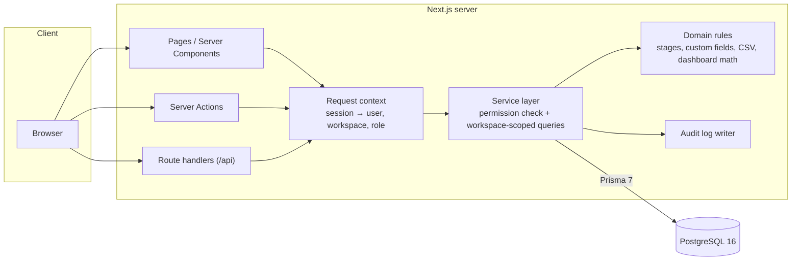
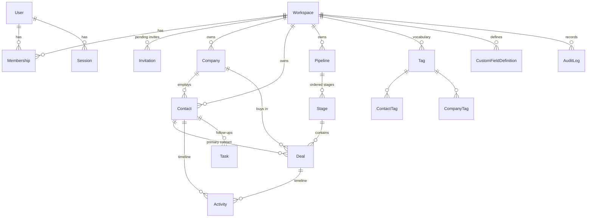

# Cadence CRM

[](https://github.com/kiresakura/cadence-crm/actions/workflows/ci.yml)

**A multi-tenant CRM for small sales teams — contacts, companies, deal pipelines, tasks and forecasting, with role-based access enforced on the server.**

[繁體中文說明](README.zh-TW.md) · [Architecture](docs/ARCHITECTURE.md) · [Design decisions](docs/DECISIONS.md) · [Security](SECURITY.md)


## Features

- **Workspaces and roles** — sign up creates a workspace; switch between workspaces; owners and admins invite people with a single-use link (valid for 7 days, accepted only by the invited email address; pending links can be regenerated or revoked) and change roles. Removing a member hands their records and open tasks to a member you choose. `OWNER`, `ADMIN`, `MEMBER` and read-only `VIEWER` are enforced in the service layer, not just hidden in the UI.
- **Contacts** — search across name, email, phone and company; filter by owner, lifecycle stage and tag; sort and paginate; detail page with company, deals, activity timeline, tasks, tags and custom fields. Linked companies and contacts are picked with a server-side search, so large workspaces work the same as small ones.
- **Duplicate detection and merge** — contacts sharing one email (case-insensitive) or one normalised phone number form a group (groups are not chained); choose who to merge and which record to keep. Merging moves activities, tasks, deals and tags, fills empty fields, and lists values that differed in a note and the audit log.
- **Companies** — list and detail with their people, deals and a combined timeline.
- **Deal pipelines** — kanban board with drag and drop (optimistic update, server validation, rollback with an error toast) plus a keyboard-friendly "Move to" menu that keeps focus on the moved card; column totals in the workspace currency; list view; won/lost handling where lost requires a reason.
- **Tasks** — my open tasks, overdue (past due), due later today and the next seven days, computed in each user's time zone; complete and reopen.
- **Dashboard** — open pipeline by stage, weighted forecast (amount × stage probability), 90-day win rate, deals expected to close this month, your overdue tasks, won revenue for six months and recent activity, all in the workspace's reporting currency.
- **CSV** — contact import with column mapping (English and Chinese headers), preview, de-duplication by email and an error report by spreadsheet row; full names are split family name first for Chinese, Japanese and Korean names; contact and deal export that respects the current filters, with spreadsheet formula-injection protection.
- **Settings** — reporting currency, pipelines and stages (rename, probability, type, reorder), tag vocabulary, custom field definitions (text, number, date, select, yes/no — changed values are validated on every save), members, invitations and roles.
- **Account** — change your name, time zone and password; changing the password signs out your other sessions.
- **Audit log** — every create, update, delete, merge, stage change and membership change with a field-level diff; visible to admins and owners.
- **Security** — a per-request nonce Content Security Policy, HSTS in production, sign-in limits per account and per client address, and forms that never put passwords in URLs (see [SECURITY.md](SECURITY.md)).
- **Polish** — responsive layout down to 375 px, keyboard-accessible controls, WCAG AA contrast (checked with axe), empty states, loading skeletons, toasts and inline form errors; deleting a record or a tag says what goes with it.

| Deals board                                            | Contacts                                            |
| ------------------------------------------------------ | --------------------------------------------------- |
|        |      |
| **Contact detail**                                     | **Deal detail**                                     |
|  |     |
| **CSV import**                                         | **Duplicate merge**                                 |
|              |  |
| **Pipeline settings**                                  |                                                     |
|    |                                                     |

## Tech stack

| Area      | Choice                                                                                                                            |
| --------- | --------------------------------------------------------------------------------------------------------------------------------- |
| Framework | Next.js 16 (App Router, Server Components, Server Actions), React 19, TypeScript (strict)                                         |
| UI        | Tailwind CSS 4, Radix primitives with shadcn/ui-style components (source in `src/components/ui`), Recharts, dnd-kit, lucide icons |
| Data      | PostgreSQL 16, Prisma 7 (driver adapter for `pg`), migrations in `prisma/migrations`, Zod 4 validation                            |
| Auth      | Email + password (Argon2id), database sessions, `httpOnly` / `SameSite=Lax` cookies (`Secure` in production)                      |
| Tests     | Vitest (unit + integration against a real database), Playwright (Chromium)                                                        |
| Quality   | ESLint, Prettier, `tsc --noEmit`                                                                                                  |
| Delivery  | Multi-stage Dockerfile (Next.js standalone), Docker Compose, GitHub Actions                                                       |

## Architecture



Every service function takes a `Ctx` (`userId`, `workspaceId`, `role`) as its first argument, checks the permission it needs, and scopes every query by `ctx.workspaceId`. Foreign ids coming from the client (company, owner, tags, stage …) are verified to belong to the same workspace before anything is written. Details in [docs/ARCHITECTURE.md](docs/ARCHITECTURE.md).

## Data model



- Money is `Decimal(14,2)` with a three-letter currency; the dashboard reports in the workspace currency and says how many deals in other currencies it left out.
- Stages have an order, a win probability and a type (`OPEN`, `WON`, `LOST`); `closedAt` and `lostReason` follow from the type.
- Custom field values live in a JSONB column per record and are validated against the workspace's definitions on every write.
- See [`prisma/schema.prisma`](prisma/schema.prisma) for the full schema.

## Quick start

### Docker (one command)

```bash
docker compose up
```

Open <http://localhost:3100> (change the port with `APP_PORT=8080 docker compose up`). The first run builds the image, applies migrations and loads the demo workspace.

| Role               | Email               | Password       |
| ------------------ | ------------------- | -------------- |
| Owner              | `owner@demo.local`  | `cadence-demo` |
| Member             | `member@demo.local` | `cadence-demo` |
| Viewer (read-only) | `viewer@demo.local` | `cadence-demo` |

The login page also has one-click buttons for these accounts. Demo accounts only work when `APP_ENV` is not `production`. Stop and remove everything with `docker compose down -v`.

**Inviting your team.** In _Settings → Members_, enter an email address and a role and choose **Create invite link**. Copy the link (it is shown once) and send it yourself. The person opens it, then signs in with that address or creates an account for it, and joins with the chosen role. Pending invitations can be regenerated or revoked from the same page.

**Reporting currency.** _Settings → Workspace_ sets the currency used by the dashboard, the board totals and new deals. Amounts are not converted; deals in other currencies are left out of totals and counted in a note.

### Local development

Requirements: Node.js 22 or newer (the app itself runs on Node 20+), Docker for PostgreSQL.

```bash
cp .env.example .env
npm ci
npm run db:up        # PostgreSQL for development (port 54329) and tests (port 54330)
npm run db:deploy    # apply migrations
npm run db:seed      # demo workspace and accounts
npm run dev          # http://localhost:3100
```

Useful scripts: `npm run db:migrate` (create a migration after editing the schema), `npm run db:down`, `npm run format`.

## Testing

```bash
npm run lint
npm run typecheck
npm test               # unit + integration (needs the test database from `npm run db:up`)
npm run test:coverage  # same, with a coverage report for src/server
npm run build
npx playwright install chromium   # once per machine: the browser Playwright drives
npm run test:e2e       # Playwright against the production build on port 3101
npm run screenshots    # regenerate docs/screenshots from the demo data
```

- **274 Vitest tests** — unit tests for pure rules (permissions matrix, secret guard, stage transitions, custom field validation, CSV parsing, name splitting and escaping, money parsing and formatting, dashboard math, time zones, redirects, security headers) and integration tests that run the real services against PostgreSQL: cross-workspace isolation, all four roles, invitations (including an account-squatting attempt), sign-in limits, record pickers with 1,500 contacts, duplicate merge, stage rules, CSV import and export, deletions, dashboard figures, sessions and members.
- **Line coverage of `src/server`: 95.3%** (the thin Next.js adapters in `src/server/next` are exercised by the Playwright suite instead).
- **54 Playwright tests** — the sales flow (create contact → deal → drag to the next stage → forecast changes), the lost-reason dialog, viewer permissions through the UI and the API, workspace switching, invitations for new and existing users, editing records in a workspace with more than 1,000 contacts, changing a linked record by typing in its picker (including failed and slow searches), moving cards from the keyboard, custom fields after settings change, member removal, reporting currency, CSV import (Chinese headers, 1.3 MB and over-2 MB files), duplicate merge, the CSP on every main page with zero violations, axe on every main page and on open toasts and pickers (no serious or critical issues), layouts at 375 and 768 px (also with the largest amounts), and forms submitted before JavaScript loads.

CI runs lint, format check, typecheck, unit, integration (PostgreSQL service), build, E2E and a Docker build on every push.

## Project structure

```
prisma/                 schema, migrations, demo seed
src/
  app/                  routes: (auth) sign-in pages, (app) CRM pages, api/ route handlers
  components/
    ui/                 Radix-based primitives (shadcn/ui style)
    records/            forms, timeline, tasks, kanban board, filters
    app-shell/          sidebar, workspace switcher, user menu
  server/
    services/           workspace-scoped use cases (contacts, deals, imports, …)
    domain/             pure business rules
    auth/               passwords, sessions, sign-in
    next/               request context, server action and API wrappers
    env.ts              APP_ENV and the production secret guard
    permissions.ts      role → permission matrix
    audit.ts            audit log writer and field diffs
  lib/                  formatting and client helpers
tests/integration/      Vitest integration tests (real PostgreSQL)
e2e/                    Playwright tests and the screenshot script
docs/                   architecture, decisions, screenshots
```

## Configuration

| Variable       | Purpose                                                                                                          |
| -------------- | ---------------------------------------------------------------------------------------------------------------- |
| `DATABASE_URL` | PostgreSQL connection string                                                                                     |
| `AUTH_SECRET`  | Key for hashing session tokens (≥ 32 random characters in production)                                            |
| `APP_ENV`      | `development`, `test`, `demo` or `production`; production refuses placeholder secrets and disables demo accounts |
| `APP_URL`      | Public URL; cookies are `Secure` when it is https (always in production); invitation links start with it         |
| `TRUST_PROXY`  | Set to `true` behind a reverse proxy that appends the client address to `X-Forwarded-For` (used for rate limits) |

## Known limitations

- No email is sent: invitation links are passed on by hand, and email addresses are not verified. An address registered by someone else cannot join workspaces that invited it, but its real owner cannot register it until verification and password reset by email exist.
- Registration says when an email is already registered (rate limited; see ADR-019).
- Amounts are not converted between currencies; totals cover the workspace currency only.
- Rate limits are kept in memory per instance; without `TRUST_PROXY` only the per-account limit applies.
- Sessions last 30 days without an idle timeout.
- Search matches substrings: no fuzzy matching, no matching of a Chinese full name typed without its parts, and no matching of the same phone number written differently.
- The board and the task list are not paginated (fine for hundreds of deals and tasks).
- A record page for a missing or foreign record shows "not found" with HTTP 200, because the loading state has already been streamed.
- CSV import: a full name that is one Latin word is reported as an error; Japanese and Korean full names need a space between family and given name.

## Roadmap

Version 2:

- Public REST API with per-workspace API keys
- Webhooks for record changes
- AI assistant (deal summaries, next-step suggestions)
- English and Traditional Chinese interface
- Hosted online demo

Also planned:

- Email delivery for invitations, email verification and password reset by email
- Session idle timeout
- Shared rate limiting for multi-instance deployments
- Fuzzy search with trigram indexes, Chinese full names and phone numbers in any format
- Pagination or virtual scrolling for the board and the task list
- A real 404 status for missing records on streamed pages
- Currency conversion with dated exchange rates
- Postgres row-level security as a second layer of tenant isolation
- Runtime argument checks at the Server Action boundary

## License

[MIT](LICENSE)
