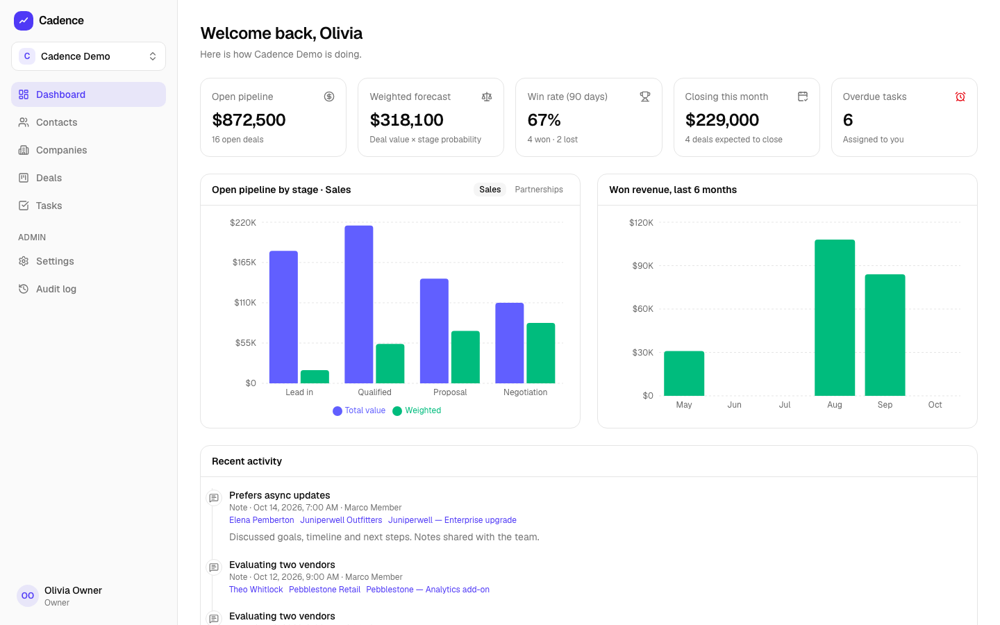
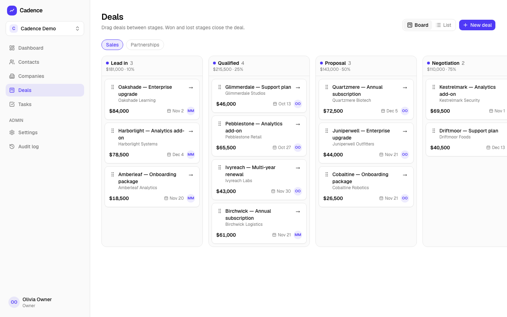
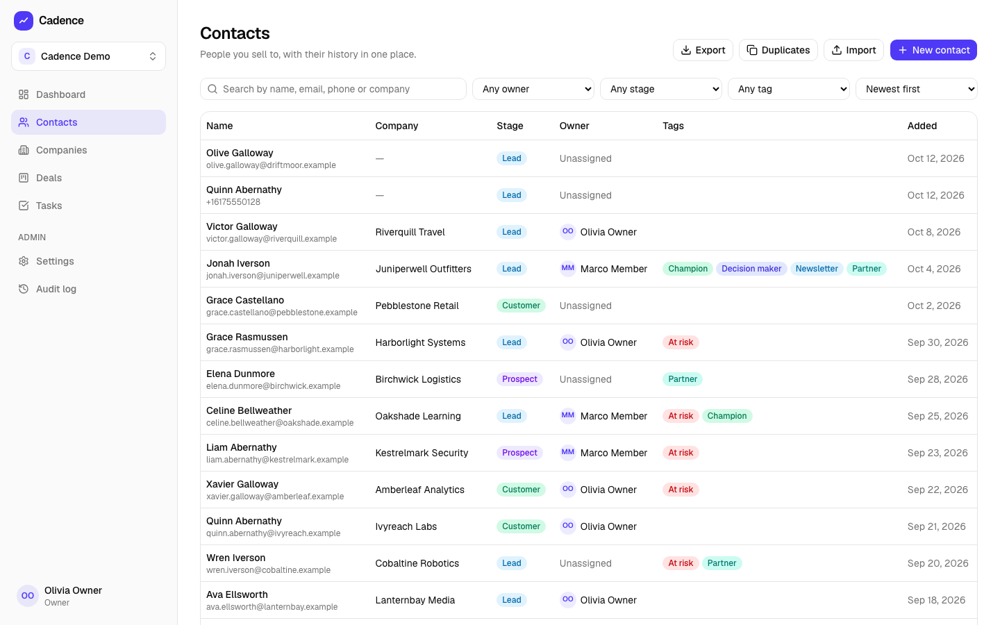
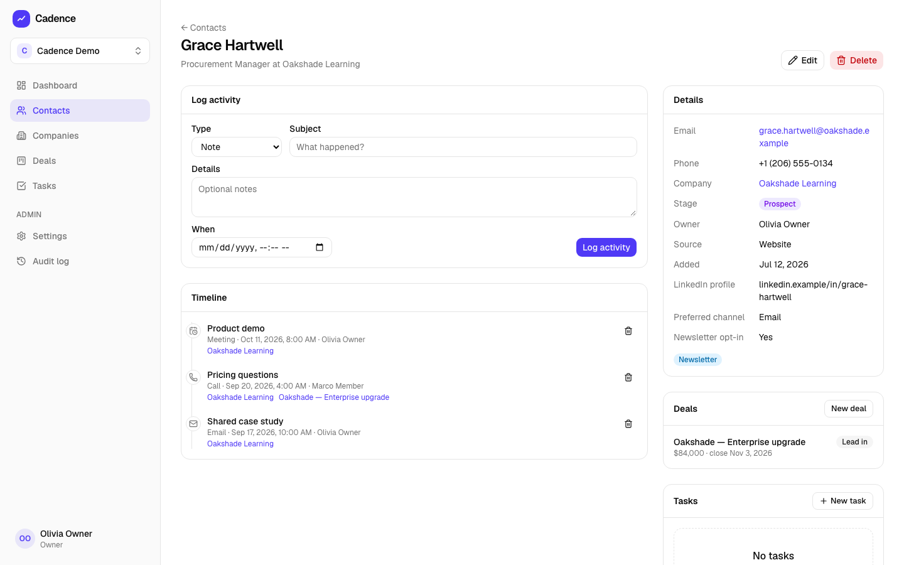
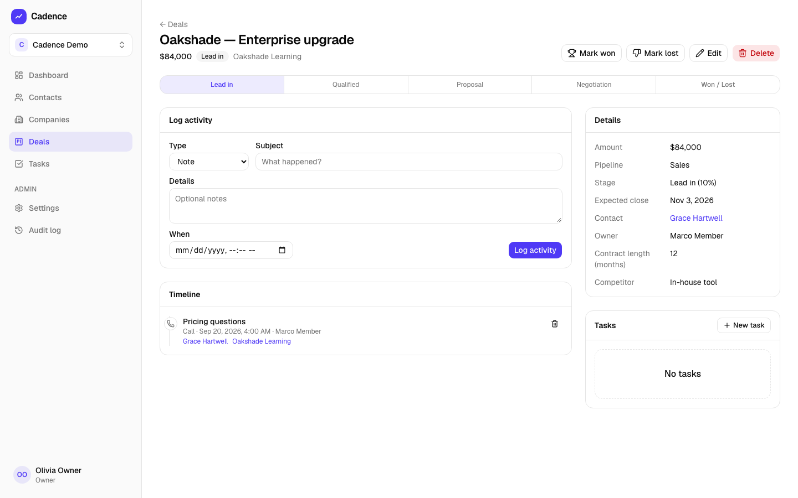
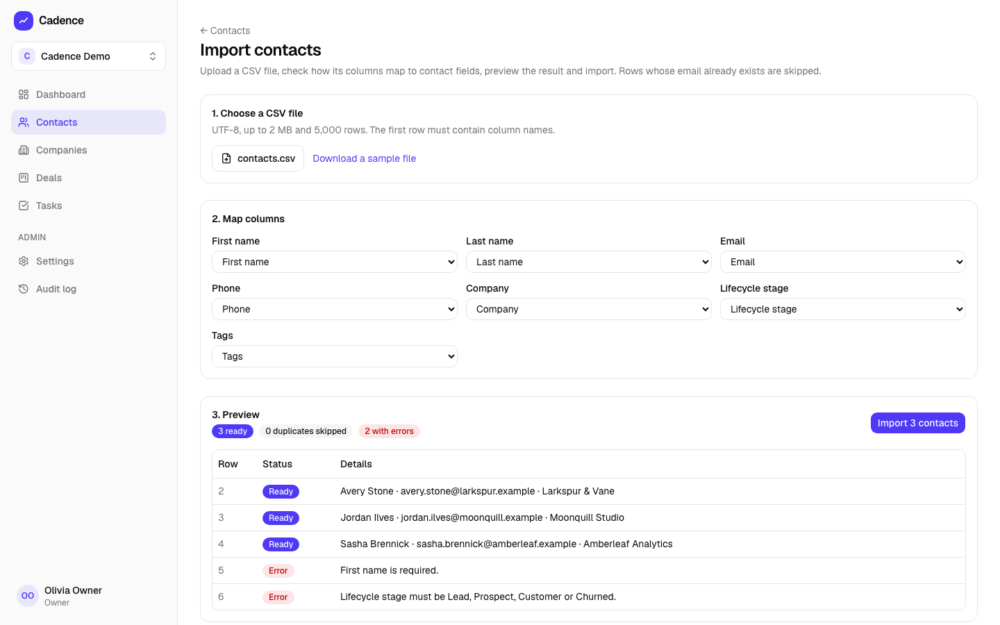
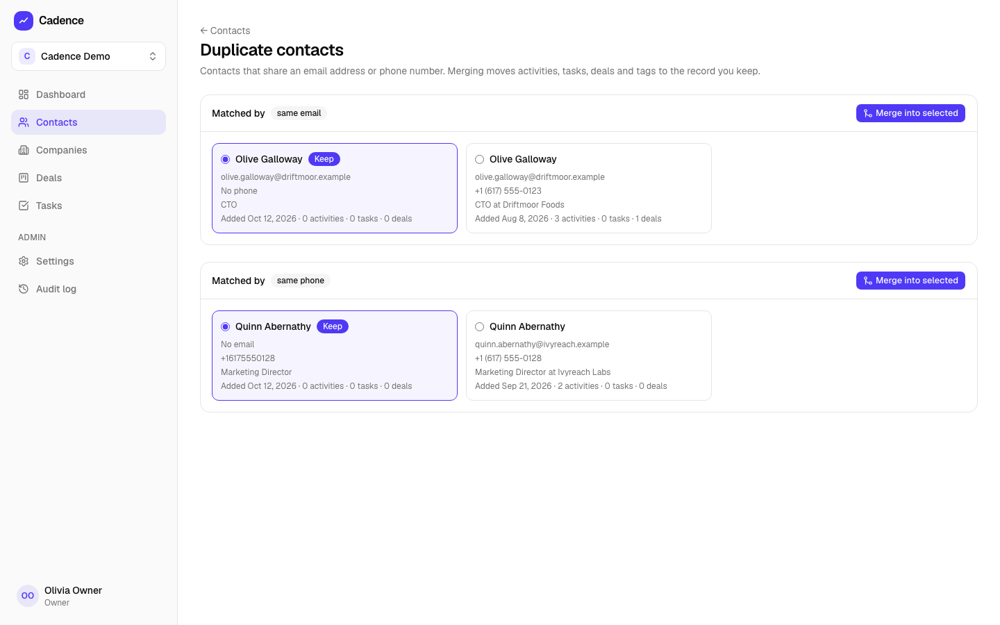
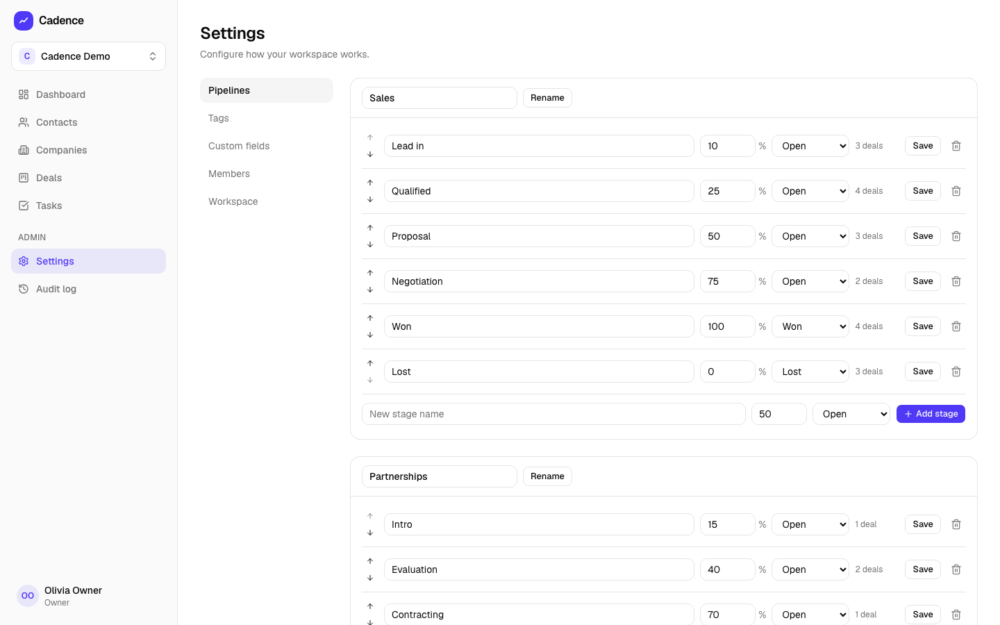
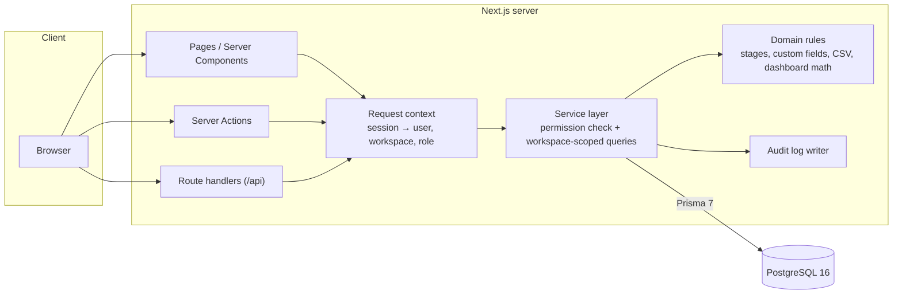
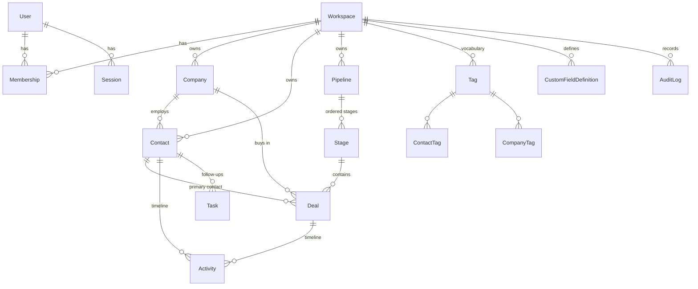

# Cadence CRM

**A multi-tenant CRM for small sales teams — contacts, companies, deal pipelines, tasks and forecasting, with role-based access enforced on the server.**

[繁體中文說明](README.zh-TW.md) · [Architecture](docs/ARCHITECTURE.md) · [Design decisions](docs/DECISIONS.md) · [Security](SECURITY.md)



## Features

- **Workspaces and roles** — sign up creates a workspace; switch between workspaces; owners and admins add members (account + temporary password) and change roles. `OWNER`, `ADMIN`, `MEMBER` and read-only `VIEWER` are enforced in the service layer, not just hidden in the UI.
- **Contacts** — search across name, email, phone and company; filter by owner, lifecycle stage and tag; sort and paginate; detail page with company, deals, activity timeline, tasks, tags and custom fields.
- **Duplicate detection and merge** — contacts sharing an email (case-insensitive) or a normalised phone number are grouped; merging moves activities, tasks, deals and tags to the kept record, fills its empty fields and writes an audit entry.
- **Companies** — list and detail with their people, deals and a combined timeline.
- **Deal pipelines** — kanban board with drag and drop (optimistic update, server validation, rollback with an error toast) plus a keyboard-friendly "Move to" menu; list view; won/lost handling where lost requires a reason.
- **Tasks** — my open tasks, overdue, due today and next seven days, computed in each user's time zone; complete and reopen.
- **Dashboard** — open pipeline by stage, weighted forecast (amount × stage probability), 90-day win rate, deals expected to close this month, overdue tasks, won revenue for six months and recent activity.
- **CSV** — contact import with column mapping, preview, de-duplication by email and a row-by-row error report; contact and deal export that respects the current filters, with spreadsheet formula-injection protection.
- **Settings** — pipelines and stages (rename, probability, type, reorder), tag vocabulary, custom field definitions (text, number, date, select, yes/no — validated on every save), members and roles.
- **Audit log** — every create, update, delete, merge, stage change and membership change with a field-level diff; visible to admins and owners.
- **Polish** — responsive layout, keyboard-accessible controls, empty states, loading skeletons, toasts and inline form errors.

| Deals board                                            | Contacts                                            |
| ------------------------------------------------------ | --------------------------------------------------- |
|        |      |
| **Contact detail**                                     | **Deal detail**                                     |
|  |     |
| **CSV import**                                         | **Duplicate merge**                                 |
|              |  |
| **Pipeline settings**                                  |                                                     |
|    |                                                     |

## Tech stack

| Area      | Choice                                                                                                                            |
| --------- | --------------------------------------------------------------------------------------------------------------------------------- |
| Framework | Next.js 16 (App Router, Server Components, Server Actions), React 19, TypeScript (strict)                                         |
| UI        | Tailwind CSS 4, Radix primitives with shadcn/ui-style components (source in `src/components/ui`), Recharts, dnd-kit, lucide icons |
| Data      | PostgreSQL 16, Prisma 7 (driver adapter for `pg`), migrations in `prisma/migrations`, Zod 4 validation                            |
| Auth      | Email + password (Argon2id), database sessions, `httpOnly` / `SameSite=Lax` cookies (`Secure` in production)                      |
| Tests     | Vitest (unit + integration against a real database), Playwright (Chromium)                                                        |
| Quality   | ESLint, Prettier, `tsc --noEmit`                                                                                                  |
| Delivery  | Multi-stage Dockerfile (Next.js standalone), Docker Compose, GitHub Actions                                                       |

## Architecture



Every service function takes a `Ctx` (`userId`, `workspaceId`, `role`) as its first argument, checks the permission it needs, and scopes every query by `ctx.workspaceId`. Foreign ids coming from the client (company, owner, tags, stage …) are verified to belong to the same workspace before anything is written. Details in [docs/ARCHITECTURE.md](docs/ARCHITECTURE.md).

## Data model



- Money is `Decimal(14,2)` with a three-letter currency; the dashboard reports in the workspace currency and says how many deals in other currencies it left out.
- Stages have an order, a win probability and a type (`OPEN`, `WON`, `LOST`); `closedAt` and `lostReason` follow from the type.
- Custom field values live in a JSONB column per record and are validated against the workspace's definitions on every write.
- See [`prisma/schema.prisma`](prisma/schema.prisma) for the full schema.

## Quick start

### Docker (one command)

```bash
docker compose up
```

Open <http://localhost:3100> (change the port with `APP_PORT=8080 docker compose up`). The first run builds the image, applies migrations and loads the demo workspace.

| Role               | Email               | Password       |
| ------------------ | ------------------- | -------------- |
| Owner              | `owner@demo.local`  | `cadence-demo` |
| Member             | `member@demo.local` | `cadence-demo` |
| Viewer (read-only) | `viewer@demo.local` | `cadence-demo` |

The login page also has one-click buttons for these accounts. Demo accounts only work when `APP_ENV` is not `production`. Stop and remove everything with `docker compose down -v`.

### Local development

Requirements: Node.js 22 or newer (the app itself runs on Node 20+), Docker for PostgreSQL.

```bash
cp .env.example .env
npm ci
npm run db:up        # PostgreSQL for development (port 54329) and tests (port 54330)
npm run db:deploy    # apply migrations
npm run db:seed      # demo workspace and accounts
npm run dev          # http://localhost:3100
```

Useful scripts: `npm run db:migrate` (create a migration after editing the schema), `npm run db:down`, `npm run format`.

## Testing

```bash
npm run lint
npm run typecheck
npm test               # unit + integration (needs the test database from `npm run db:up`)
npm run test:coverage  # same, with a coverage report for src/server
npm run build
npm run test:e2e       # Playwright against the production build on port 3101
npm run screenshots    # regenerate docs/screenshots from the demo data
```

- **146 Vitest tests** — unit tests for pure rules (permissions matrix, secret guard, stage transitions, custom field validation, CSV parsing and escaping, dashboard math, time zones) and integration tests that run the real services against PostgreSQL: cross-workspace isolation, all four roles, duplicate merge, stage rules, CSV import and export, dashboard figures, sessions and members.
- **Line coverage of `src/server`: 94%.**
- **5 Playwright tests** — sign in → create contact → create deal → drag it to the next stage → dashboard forecast changes; lost-reason dialog; a viewer sees no edit controls and the API rejects their writes with 403; unauthenticated API calls get 401; registration.

CI runs lint, format check, typecheck, unit, integration (PostgreSQL service), build, E2E and a Docker build on every push.

## Project structure

```
prisma/                 schema, migrations, demo seed
src/
  app/                  routes: (auth) sign-in pages, (app) CRM pages, api/ route handlers
  components/
    ui/                 Radix-based primitives (shadcn/ui style)
    records/            forms, timeline, tasks, kanban board, filters
    app-shell/          sidebar, workspace switcher, user menu
  server/
    services/           workspace-scoped use cases (contacts, deals, imports, …)
    domain/             pure business rules
    auth/               passwords, sessions, sign-in
    next/               request context, server action and API wrappers
    env.ts              APP_ENV and the production secret guard
    permissions.ts      role → permission matrix
    audit.ts            audit log writer and field diffs
  lib/                  formatting and client helpers
tests/integration/      Vitest integration tests (real PostgreSQL)
e2e/                    Playwright tests and the screenshot script
docs/                   architecture, decisions, screenshots
```

## Configuration

| Variable       | Purpose                                                                                                          |
| -------------- | ---------------------------------------------------------------------------------------------------------------- |
| `DATABASE_URL` | PostgreSQL connection string                                                                                     |
| `AUTH_SECRET`  | Key for hashing session tokens (≥ 32 random characters in production)                                            |
| `APP_ENV`      | `development`, `test`, `demo` or `production`; production refuses placeholder secrets and disables demo accounts |
| `APP_URL`      | Public URL; cookies are `Secure` when it is https (always in production)                                         |

## Roadmap

Version 2:

- Public REST API with per-workspace API keys
- Webhooks for record changes
- AI assistant (deal summaries, next-step suggestions)
- English and Traditional Chinese interface
- Hosted online demo

Also planned: email delivery for invitations and password reset, Postgres row-level security as a second layer of tenant isolation, shared rate limiting for multi-instance deployments, trigram indexes for fuzzy search.

## License

[MIT](LICENSE)
