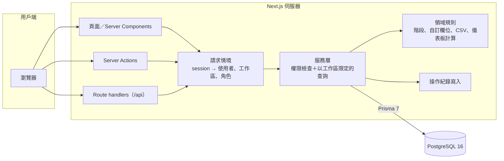
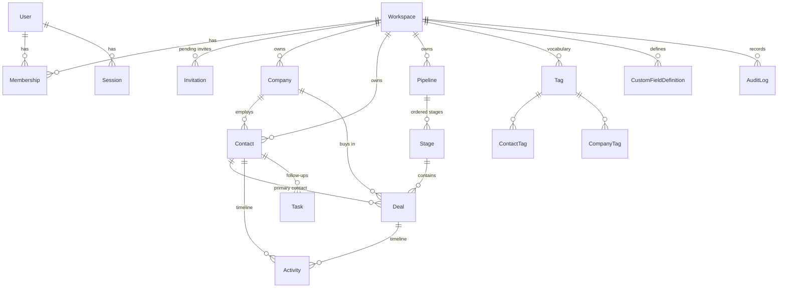

# Cadence CRM

[](https://github.com/kiresakura/cadence-crm/actions/workflows/ci.yml)

**為小型業務團隊打造的多租戶 CRM：聯絡人、公司、商機管線、待辦與業績預測，角色權限一律在伺服器端強制。**

[English](README.md) · [架構說明](docs/ARCHITECTURE.md) · [設計取捨](docs/DECISIONS.md) · [安全政策](SECURITY.md)


## 功能

- **工作區與角色**：註冊即建立工作區，可在多個工作區之間切換；擁有者與管理員以單次有效的邀請連結邀請成員（7 天內有效，只有受邀 Email 的帳號能接受；待接受的邀請可重新產生連結或撤銷）、調整角色。移除成員時，其負責的紀錄與未完成待辦轉給指定的成員。`OWNER`、`ADMIN`、`MEMBER` 與唯讀的 `VIEWER` 由服務層強制執行，不只是在畫面上隱藏按鈕。
- **聯絡人**：以姓名、Email、電話、公司搜尋；依負責人、生命週期、標籤篩選；排序與分頁；詳情頁含公司、商機、互動時間軸、待辦、標籤與自訂欄位。關聯的公司與聯絡人以伺服器搜尋挑選，資料量大的工作區也一樣好用。
- **重複偵測與合併**：同一個 Email（不分大小寫）或同一個正規化電話的聯絡人列為一組（群組不會串連）；可勾選要合併的人並選擇保留者。合併時把互動、待辦、商機、標籤搬到保留的那筆、補齊空白欄位，不同的值記在備註與操作紀錄裡。
- **公司**：清單與詳情，含旗下聯絡人、商機與彙整時間軸。
- **商機管線**：看板拖拉換階段（樂觀更新、伺服器驗證、失敗回滾並提示），另有可用鍵盤操作的「移到…」選單；欄位合計以工作區幣別計算；清單檢視；標記成交／失單（失單必填原因）。
- **待辦**：我的待辦、逾期（已過期限）、今天稍後到期、未來七天，依每位使用者的時區計算；可完成與取消完成。
- **儀表板**：各階段進行中金額、加權預測（金額 × 階段勝率）、近 90 天勝率、本月預計成交、我的逾期待辦、近六個月成交金額與最近動態，全部以工作區的報表幣別呈現。
- **CSV**：聯絡人匯入（欄位對應，支援中英文標題、預覽、依 Email 去重、依試算表行號的錯誤報告；中日韓全名依「姓在前」拆分）；聯絡人與商機匯出（套用目前篩選，並防範試算表公式注入）。
- **設定**：報表幣別、管線與階段（改名、勝率、類型、排序）、標籤、自訂欄位定義（文字、數字、日期、選單、是／否，有變動的值每次儲存都會驗證）、成員、邀請與角色。
- **帳號**：修改姓名、時區與密碼；改密碼會登出其他裝置上的 session。
- **操作紀錄**：新增、修改、刪除、合併、換階段、成員異動都有欄位層級的差異紀錄，管理員以上可查看。
- **安全**：每次請求產生 nonce 的 Content Security Policy、production 的 HSTS、依帳號與來源位址的登入限流，表單不會把密碼放進網址（見 [SECURITY.md](SECURITY.md)）。
- **體驗**：響應式版面（最窄 375 px）、可鍵盤操作、符合 WCAG AA 的對比（以 axe 檢查）、空狀態、載入骨架、操作提示（toast）與欄位錯誤訊息；刪除紀錄或標籤前會說明連帶影響。

| 商機看板                                           | 聯絡人                                        |
| -------------------------------------------------- | --------------------------------------------- |
|       |  |
| **聯絡人詳情**                                     | **商機詳情**                                  |
|  |  |
| **CSV 匯入**                                       | **重複合併**                                  |
|            |   |
| **管線設定**                                       |                                               |
|    |                                               |

## 技術棧

| 面向 | 選擇                                                                                                               |
| ---- | ------------------------------------------------------------------------------------------------------------------ |
| 框架 | Next.js 16（App Router、Server Components、Server Actions）、React 19、TypeScript（strict）                        |
| 介面 | Tailwind CSS 4、以 Radix 為底的 shadcn/ui 風格元件（原始碼在 `src/components/ui`）、Recharts、dnd-kit、lucide 圖示 |
| 資料 | PostgreSQL 16、Prisma 7（`pg` driver adapter）、migration 收在 `prisma/migrations`、Zod 4 驗證                     |
| 認證 | Email＋密碼（Argon2id）、資料庫 session、`httpOnly`／`SameSite=Lax` cookie（production 加 `Secure`）               |
| 測試 | Vitest（單元＋對真實資料庫的整合測試）、Playwright（Chromium）                                                     |
| 品質 | ESLint、Prettier、`tsc --noEmit`                                                                                   |
| 交付 | 多階段 Dockerfile（Next.js standalone）、Docker Compose、GitHub Actions                                            |

## 架構



每個服務函式的第一個參數都是 `Ctx`（`userId`、`workspaceId`、`role`）：先檢查所需權限，所有查詢都以 `ctx.workspaceId` 限定；用戶端傳來的外部 id（公司、負責人、標籤、階段…）寫入前都會確認屬於同一個工作區。細節見 [docs/ARCHITECTURE.md](docs/ARCHITECTURE.md)。

## 資料模型



- 金額使用 `Decimal(14,2)` 並記錄三碼幣別；儀表板以工作區幣別統計，並註明排除了幾筆其他幣別的商機。
- 階段有順序、勝率與類型（`OPEN`、`WON`、`LOST`）；`closedAt` 與 `lostReason` 依類型自動處理。
- 自訂欄位的值存在各筆資料的 JSONB 欄位，每次寫入都依工作區的欄位定義驗證。
- 完整定義見 [`prisma/schema.prisma`](prisma/schema.prisma)。

## 快速開始

### Docker（一行指令）

```bash
docker compose up
```

開啟 <http://localhost:3100>（可用 `APP_PORT=8080 docker compose up` 換埠）。第一次執行會建置映像、套用 migration 並載入示範工作區。

| 角色           | Email               | 密碼           |
| -------------- | ------------------- | -------------- |
| 擁有者         | `owner@demo.local`  | `cadence-demo` |
| 成員           | `member@demo.local` | `cadence-demo` |
| 檢視者（唯讀） | `viewer@demo.local` | `cadence-demo` |

登入頁也有一鍵登入按鈕。示範帳號只在 `APP_ENV` 不是 `production` 時有效。結束並清除資料：`docker compose down -v`。

**邀請團隊成員**：在「設定 → Members」輸入 Email 與角色，按 **Create invite link**。複製連結（只顯示一次）後自行傳給對方。對方開啟連結，用該 Email 登入或替該 Email 建立帳號，即以指定角色加入。待接受的邀請可在同一頁重新產生連結或撤銷。

**報表幣別**：「設定 → Workspace」設定儀表板、看板合計與新商機使用的幣別。金額不做換算；其他幣別的商機不計入合計，另以註記說明筆數。

### 本機開發

需求：Node.js 22 以上（應用程式本身支援 Node 20+）、用來跑 PostgreSQL 的 Docker。

```bash
cp .env.example .env
npm ci
npm run db:up        # 開發用 PostgreSQL（54329 埠）與測試用（54330 埠）
npm run db:deploy    # 套用 migration
npm run db:seed      # 示範工作區與帳號
npm run dev          # http://localhost:3100
```

其他指令：`npm run db:migrate`（修改 schema 後建立 migration）、`npm run db:down`、`npm run format`。

## 測試

```bash
npm run lint
npm run typecheck
npm test               # 單元＋整合測試（需要 `npm run db:up` 啟動的測試資料庫）
npm run test:coverage  # 同上，附 src/server 覆蓋率
npm run build
npx playwright install chromium   # 每台機器一次：安裝 Playwright 使用的瀏覽器
npm run test:e2e       # 對 3101 埠的 production build 跑 Playwright
npm run screenshots    # 用示範資料重新產生 docs/screenshots
```

- **257 個 Vitest 測試**：純規則的單元測試（權限矩陣、secret guard、階段轉換、自訂欄位驗證、CSV 解析、姓名拆分與跳脫、金額解析與格式、儀表板計算、時區、登入後導向、安全標頭），以及直接對 PostgreSQL 執行真實服務的整合測試：跨工作區隔離、四種角色、邀請（含帳號預先佔用的攻擊）、登入限流、1,500 筆聯絡人下的關聯挑選、重複合併、階段規則、CSV 匯入匯出、刪除、儀表板數字、session 與成員管理。
- **`src/server` 行覆蓋率：95.2%**（`src/server/next` 這層 Next.js 轉接程式改由 Playwright 測試覆蓋）。
- **38 個 Playwright 測試**：業務流程（建聯絡人 → 建商機 → 拖到下一階段 → 預測數字變化）、失單原因對話框、檢視者在介面與 API 上的權限、工作區切換、新舊使用者的邀請流程、聯絡人超過 1,000 筆時編輯紀錄、設定變更後的自訂欄位、移除成員、報表幣別、CSV 匯入（中文標題、1.3 MB 與超過 2 MB 的檔案）、重複合併、各主要頁面的 CSP 與 0 個違規、axe（無 serious／critical）、375 與 768 px 版面，以及 JavaScript 尚未載入時送出表單。

CI 會在每次 push 執行 lint、格式檢查、型別檢查、單元、整合（PostgreSQL service）、建置、E2E 與 Docker 建置。

## 專案結構

```
prisma/                 schema、migration、示範資料 seed
src/
  app/                  路由：(auth) 登入相關、(app) CRM 頁面、api/ route handlers
  components/
    ui/                 以 Radix 為底的基礎元件（shadcn/ui 風格）
    records/            表單、時間軸、待辦、看板、篩選列
    app-shell/          側欄、工作區切換、使用者選單
  server/
    services/           以工作區限定的使用案例（聯絡人、商機、匯入…）
    domain/             純業務規則
    auth/               密碼、session、登入
    next/               請求情境、server action 與 API 包裝
    env.ts              APP_ENV 與 production secret guard
    permissions.ts      角色 → 權限矩陣
    audit.ts            操作紀錄與欄位差異
  lib/                  格式化與前端輔助
tests/integration/      Vitest 整合測試（真實 PostgreSQL）
e2e/                    Playwright 測試與截圖腳本
docs/                   架構、設計取捨、截圖
```

## 設定

| 變數           | 用途                                                                                 |
| -------------- | ------------------------------------------------------------------------------------ |
| `DATABASE_URL` | PostgreSQL 連線字串                                                                  |
| `AUTH_SECRET`  | session token 雜湊用金鑰（production 至少 32 個隨機字元）                            |
| `APP_ENV`      | `development`、`test`、`demo` 或 `production`；production 拒絕預設密鑰並停用示範帳號 |
| `APP_URL`      | 對外網址；https 時 cookie 會加上 `Secure`（production 一律加上）；邀請連結以它開頭   |
| `TRUST_PROXY`  | 前面有會把來源位址附加到 `X-Forwarded-For` 的反向代理時設為 `true`（限流使用）       |

## 已知限制

- 不寄送 Email：邀請連結由邀請者自行轉交，Email 也未經驗證。被別人先註冊走的 Email 無法加入邀請它的工作區，但真正的本人也無法註冊同一個 Email，要等 Email 驗證與寄信重設密碼上線。
- 註冊時會說明「此 Email 已有帳號」（有頻率限制，見 ADR-019）。
- 不同幣別之間不換算；合計只計工作區幣別。
- 限流計數存在單一實例的記憶體；未設定 `TRUST_PROXY` 時只有依帳號的限制。
- Session 有效 30 天，沒有閒置逾時。
- 搜尋以子字串比對：沒有模糊比對，中文全名連打找不到分開存的姓與名，同一支電話寫法不同也找不到。
- 看板與待辦清單沒有分頁（數百筆內沒有問題）。
- 不存在或屬於其他工作區的紀錄頁會顯示「找不到」，但 HTTP 狀態碼是 200，因為載入畫面已先串流送出。
- CSV 匯入：只有一個拉丁字的全名會列為錯誤；日文與韓文全名需要以空白分隔姓與名。

## Roadmap

第二版：

- 對外 REST API 與工作區 API 金鑰
- 資料異動 Webhook
- AI 助手（商機摘要、下一步建議）
- 中英雙語介面
- 線上 Demo

另外規劃：

- 邀請信、Email 驗證與寄信重設密碼
- Session 閒置逾時
- 多實例共用的限流
- 模糊搜尋（trigram 索引、中文全名、各種電話寫法）
- 看板與待辦清單的分頁或虛擬捲動
- 串流頁面上找不到紀錄時回傳真正的 404
- 依日期匯率換算幣別
- 以 Postgres row-level security 作為第二層租戶隔離
- Server Action 邊界的執行期參數檢查

## 授權

[MIT](LICENSE)
